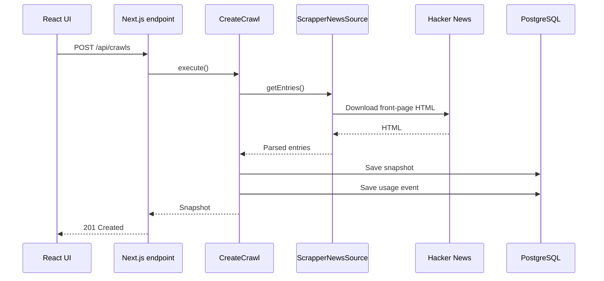

# Scrapper News

A full-stack application that scrapes the first 30 entries from Hacker News, filters them by title length, and records usage information in PostgreSQL.

Built with Next.js, React, TypeScript, Cheerio, Neon, Zod, and Playwright Test.

**Live demo:** https://jose-web-scrapper.vercel.app/ 
**Repository:** https://github.com/Jose2020Try/Jose_webScrapper

## Overview

Scrapper News captures a snapshot of the Hacker News front page and lets users explore that snapshot using two filters:

- Titles with **more than five words**, ordered by the number of comments.
- Titles with **five words or fewer**, ordered by points.

Both filters operate on the same saved snapshot. Changing a filter does not scrape Hacker News again.

The application also records crawl and filter operations, including the request timestamp, applied filter, result count, duration, and outcome.

## Features

- Scrapes the first 30 entries from the Hacker News front page.
- Extracts each entry's original rank, title, points, and comment count.
- Persists snapshots in PostgreSQL.
- Applies filtering and sorting on the server.
- Records successful and failed operations when usage storage is available.
- Provides a React interface with loading, error, and empty states.
- Preserves existing results when a filter request fails.
- Includes automated tests for business rules, parsing, application behavior, and browser interactions.
- Supports deployment on Vercel with Neon.

## Technology Stack

| Technology | Responsibility |
| --- | --- |
| Next.js App Router | Application framework and HTTP endpoints |
| React | Interactive user interface |
| TypeScript | Static types and application contracts |
| Native `fetch` | Downloading the Hacker News HTML |
| Cheerio | Parsing and extracting data from HTML |
| PostgreSQL / Neon | Persistent snapshots and usage events |
| Neon serverless driver | Parameterized database queries |
| Zod | Runtime validation of external data and HTTP inputs |
| Playwright Test | Automated unit and browser tests |
| CSS Modules | Component-scoped styling |
| Vercel | Application deployment |

The project uses manual dependency injection. It does not require a dependency injection container or an ORM.

## Requirements and Assumptions

### Extracted fields

Each entry contains:

| Field | Meaning |
| --- | --- |
| `rank` | Original position on the Hacker News front page |
| `title` | Entry title |
| `points` | Displayed point count |
| `comments` | Displayed comment count |

The original requirement's “number” field is represented as `rank`.

Ranks are preserved after filtering. The application does not renumber the results.

### Filter behavior

| Filter | Selection | Ordering |
| --- | --- | --- |
| `all` | All entries in the snapshot | Original order |
| `long-title` | More than five words | Comments descending |
| `short-title` | Five words or fewer | Points descending |

When two entries have equal values for the primary sorting field, the entry with the lower original rank appears first.

Descending order and rank-based tie-breaking are explicit implementation decisions.

### Word counting

Titles are split by whitespace. A token counts as a word when it contains at least one Unicode letter or number.

This means:

- Standalone punctuation and symbols are ignored.
- Repeated spaces, tabs, and line breaks act as separators.
- Hyphenated words remain one token.
- Numbers count as words.
- Accented letters are supported.
- Punctuation within a token does not split it into multiple words.

Examples:

| Title | Word count |
| --- | ---: |
| `This is - a self-explained example` | 5 |
| `Hello world` | 2 |
| `Next.js 2026` | 2 |
| `Hola mundo` | 2 |
| `--- !!!` | 0 |

The implementation follows whitespace-based counting rather than linguistic word segmentation.

### Missing and invalid data

Entries without displayed points or comments are normalized to `0`.

The Hacker News label `discuss` is interpreted as zero comments.

Missing values and malformed values are handled differently:

- Missing optional score or comment information becomes `0`.
- Malformed numeric text produces an error.
- Missing titles or required row structure produce an error.
- Fewer than 30 detected entries produce an error.
- Additional entries beyond the first 30 are ignored.

This prevents unexpected HTML from silently becoming a successful empty result.

## Getting Started

### Prerequisites

- Node.js 22.x
- npm
- A Neon PostgreSQL database

The project was developed using Node.js 22 and npm 10.

### 1. Clone the repository

Replace the repository URL before running:

```bash
git clone <REPOSITORY_URL> hacker-news-crawler
cd hacker-news-crawler
```

### 2. Install dependencies

```bash
npm ci
```

Using `npm ci` installs the dependency versions recorded in `package-lock.json`.

### 3. Configure environment variables

Create `.env.local` in the project root:

```dotenv
DATABASE_URL="YOUR_NEON_POSTGRESQL_CONNECTION_STRING"
```

Obtain the connection string from your Neon project.

Keep `.env.local` out of version control. `.env.example` documents the required variable without including credentials.

`DATABASE_URL` is a server-only variable. It must not use the `NEXT_PUBLIC_` prefix.

### 4. Create the database tables

Open the Neon SQL Editor and execute:

```text
db/migrations/001_initial.sql
```

Run this initial migration once against an empty target database.

It creates:

- `crawl_snapshots`
- `usage_events`

Verify the setup:

```sql
SELECT COUNT(*) FROM crawl_snapshots;
SELECT COUNT(*) FROM usage_events;
```

A newly initialized database should return zero for both tables.

### 5. Start the development server

```bash
npm run dev
```

Open [http://localhost:3000](http://localhost:3000).

Click **Load entries** to create the first snapshot.

## Using the Application

1. Click **Load entries** to download and store 30 entries.
2. Select **More than 5 words** to sort matching entries by comments.
3. Select **5 words or fewer** to sort matching entries by points.
4. Select **All entries** to restore the full snapshot.
5. Click **Refresh entries** to create a new snapshot from the current front page.

The captured timestamp identifies when the displayed snapshot was created.

Controls are disabled while a request is pending. If filtering fails, the previous successful results remain visible.

## Architecture

The project uses a lightweight Clean Architecture approach.

The goal is to keep business rules independent of the framework, external HTML, and database implementation.

### Layers

| Layer | Responsibility | Examples |
| --- | --- | --- |
| Domain | Data models and business rules | `Entry`, `CrawlSnapshot`, word counting, filtering |
| Application | Coordinate operations through contracts | `CreateCrawl`, `GetFilteredEntries`, repository ports |
| Infrastructure | Implement external integrations | HTTP source, HTML parser, PostgreSQL repositories |
| Presentation | Handle user interactions and HTTP | React components and Next.js route handlers |
| Composition | Connect concrete dependencies | `dependencies.ts` |
| Contracts | Share runtime data validation | `entrySchema` |

### Project structure

```text
src/
├── app/
│   ├── page.tsx
│   └── api/
│       └── crawls/
│           ├── route.ts
│           └── [id]/
│               └── entries/
│                   └── route.ts
├── components/
│   ├── crawler.tsx
│   └── crawler.module.css
├── contracts/
│   └── entry-schema.ts
├── domain/
│   ├── entry.ts
│   ├── crawl-snapshot.ts
│   ├── count-words.ts
│   └── filter-entries.ts
├── application/
│   ├── ports/
│   │   ├── entry-source.ts
│   │   ├── snapshot-repository.ts
│   │   └── usage-repository.ts
│   ├── services/
│   │   └── run-with-usage.ts
│   └── use-cases/
│       ├── create-crawl.ts
│       └── get-filtered-entries.ts
├── infrastructure/
│   ├── scraping/
│   │   └── HTTP source and HTML parser
│   └── persistence/
│       ├── database.ts
│       ├── map-snapshot-row.ts
│       ├── postgres-snapshot-repository.ts
│       └── postgres-usage-repository.ts
└── composition/
    └── dependencies.ts

db/
└── migrations/
    └── 001_initial.sql

tests/
├── unit/
├── browser/
└── fixtures/
```

The scraping directory contains `scrapper-news-source.ts` and the HTML parser.

### Creating a snapshot



Usage recording is coordinated by the shared `runWithUsage` function.

### Filtering a snapshot

Filtering follows a different path:

1. The UI sends the snapshot ID and selected filter.
2. The endpoint validates both values.
3. `GetFilteredEntries` retrieves the saved snapshot.
4. `filterEntries` applies the domain rules.
5. The operation records a usage event.
6. The endpoint returns the filtered results.

This operation does not call the scraper.

### Dependency direction

Use cases depend on application-owned interfaces:

- `EntrySource`
- `SnapshotRepository`
- `UsageRepository`

Infrastructure classes implement those interfaces.

The composition root selects the real implementations and passes them to the use cases.

Domain functions do not import Next.js, Cheerio, Neon, or React.

## Design Decisions

### Why Clean Architecture?

The application contains concerns that change independently:

- Filtering requirements can change.
- Hacker News can change its HTML.
- Database access can change.
- The UI can change.

Separating these responsibilities makes changes easier to locate and allows business rules to be tested without starting a web server or connecting to a database.

The trade-off is additional files and dependency wiring. The implementation keeps this structure small and avoids a dependency injection framework.

### Manual dependency injection

Dependencies are passed explicitly through constructors.

`CreateCrawl` receives:

- An entry source.
- A snapshot repository.
- A usage repository.
- A clock function.
- An ID generator.

Tests can replace these dependencies with controlled implementations.

Injecting the clock and ID generator also makes test results deterministic.

### Repository Pattern

Repositories encapsulate persistence operations:

- `SnapshotRepository` saves and retrieves snapshots.
- `UsageRepository` records usage events.

Application code expresses what should be stored without knowing how the SQL is written.

The PostgreSQL implementations use parameterized queries through the Neon driver.

### Adapters and mapping

`ScrapperNewsSource` adapts an external website to the `EntrySource` contract.

The parser converts HTML into `Entry` objects.

`mapSnapshotRow` validates database results and maps SQL field names, such as `captured_at`, to application names, such as `capturedAt`.

### Shared execution recording

`runWithUsage` wraps an asynchronous operation with timing and usage recording.

Both use cases reuse this function instead of duplicating success and failure logging.

If the operation and its usage recording both fail, an `AggregateError` preserves both causes.

### Functions for domain rules

Word counting and filtering are implemented as pure functions.

They do not perform network requests, write to storage, or mutate the original entries array.

This keeps the core behavior predictable and easy to test.

## SOLID Principles

| Principle | Application in this project |
| --- | --- |
| Single Responsibility | Parsing, filtering, HTTP handling, and persistence are separate responsibilities. |
| Open/Closed | A different `EntrySource` implementation can be connected without rewriting the crawl use case. |
| Liskov Substitution | Alternative repository implementations must preserve the same behavioral contracts, including missing-record behavior. |
| Interface Segregation | Ports expose small sets of operations instead of one large infrastructure interface. |
| Dependency Inversion | Use cases depend on application contracts rather than concrete database or scraping implementations. |

These principles guide the design rather than serving as an absolute checklist.

For example, `SnapshotRepository` combines reading and writing. A larger application could split these responsibilities into separate interfaces.

Adding a new filter also requires coordinated changes to validation, domain behavior, UI options, and database constraints.

## Database Design

### `crawl_snapshots`

Stores immutable application snapshots.

| Column | Purpose |
| --- | --- |
| `id` | Snapshot UUID |
| `captured_at` | Capture timestamp |
| `entries` | JSONB array containing 30 entries |

Snapshots are stored as JSONB because the application retrieves and processes a small collection as a whole.

This design favors simplicity for the current access pattern. A normalized entry table could become useful for cross-snapshot querying or larger datasets.

### `usage_events`

Stores execution information.

| Column | Purpose |
| --- | --- |
| `id` | Event UUID |
| `requested_at` | Operation start timestamp |
| `operation` | `crawl` or `filter` |
| `applied_filter` | Selected filter, or `NULL` for crawling |
| `snapshot_id` | Related snapshot when available |
| `result_count` | Number of returned entries when successful |
| `duration_ms` | Elapsed operation time before saving the usage event |
| `status` | `success` or `error` |

Timestamps are supplied as UTC ISO strings and stored using PostgreSQL `TIMESTAMPTZ`.

Filter requests rejected during HTTP input validation do not reach the use case and are not included in this usage table.

## API Reference

### Create a snapshot

```http
POST /api/crawls
```

No request body is required.

Successful response: `201 Created`.

Response fields:

```ts
{
  id: string;
  capturedAt: string;
  entries: Array<{
    rank: number;
    title: string;
    points: number;
    comments: number;
  }>;
}
```

A successful capture contains exactly 30 entries.

### Retrieve filtered entries

```http
GET /api/crawls/{snapshotId}/entries?filter=long-title
```

Supported filters:

- `all`
- `long-title`
- `short-title`

If `filter` is omitted, the endpoint uses `all`.

Successful response: `200 OK`.

Response fields:

```ts
{
  snapshotId: string;
  capturedAt: string;
  filter: "all" | "long-title" | "short-title";
  entries: Array<{
    rank: number;
    title: string;
    points: number;
    comments: number;
  }>;
}
```

Responses include `Cache-Control: no-store` to prevent HTTP response caching from bypassing subsequent requests and their usage recording.

### Error responses

HTTP errors use this structure:

```json
{
  "error": {
    "code": "INVALID_INPUT",
    "message": "Provide a valid snapshot ID and filter."
  }
}
```

| Status | Meaning |
| --- | --- |
| `400` | Invalid snapshot ID or filter |
| `404` | Snapshot does not exist |
| `502` | The external source could not be downloaded or parsed |
| `500` | Unexpected application, persistence, or usage-recording failure |

### PowerShell example

Run these commands in the same terminal session:

```powershell
$baseUrl = "http://localhost:3000"

$snapshot = Invoke-RestMethod `
  -Uri "$baseUrl/api/crawls" `
  -Method Post

$snapshotId = $snapshot.id

$long = Invoke-RestMethod `
  -Uri "$baseUrl/api/crawls/${snapshotId}/entries?filter=long-title"

$short = Invoke-RestMethod `
  -Uri "$baseUrl/api/crawls/${snapshotId}/entries?filter=short-title"

$long.entries.Count + $short.entries.Count
```

The final value should be `30`.

To test a deployed application, replace the local base URL with its deployment URL.

## Testing

Playwright Test is used as the test runner for both unit and browser tests.

Unit tests do not request browser fixtures, so they do not launch a browser.

### Install the browser

```bash
npx playwright install chromium
```

### Run all tests

```bash
npm test
```

### Run unit tests

```bash
npx playwright test --project=unit
```

### Run browser tests

```bash
npm run test:browser
```

### Run browser tests visibly

```bash
npm run test:browser:headed
```

### Open the HTML report

```bash
npm run test:report
```

### Static checks

```bash
npm run typecheck
npm run lint
```

### Test coverage

The automated suite checks:

- Word counting and symbol handling.
- Five-word and six-word boundaries.
- Filter selection, ordering, and tie-breaking.
- Preservation of the original entries.
- HTML parsing and malformed data.
- HTTP source success and failure scenarios.
- Handling of a simulated timeout error.
- Snapshot mapping and validation.
- Use-case orchestration and usage recording.
- Propagation of operation and logging failures.
- Loading, filtering, refreshing, and empty browser states.
- Retry behavior and preservation of previous results after errors.
- Disabled controls during pending requests.

### What the browser tests verify

Browser tests intercept API requests and return controlled responses.

They verify:

- User interactions.
- Rendered results.
- Requested filters and snapshot IDs.
- Loading and recovery behavior.

They do not prove that real database writes or live scraping work.

Live HTTP requests and Neon queries are checked separately during manual integration and deployment verification.

The automated suite currently does not include a real PostgreSQL integration test.

### Test server behavior

The Playwright configuration starts the development server when needed and can reuse an existing local server.

Because `webServer` is configured globally, it is checked even when only the unit project is selected.

Failure diagnostics include screenshots, traces, and an HTML report.

## Production Build

Run the checks before building:

```bash
npm run typecheck
npm run lint
npm test
npm run build
```

To run the production build locally:

```bash
npm run start
```

Stop an existing development server first if it is using the same port.

The build command does not replace running the test suite.

## Deployment

The application can be deployed to Vercel with Neon providing PostgreSQL.

### Vercel configuration

| Setting | Value |
| --- | --- |
| Framework | Next.js |
| Root directory | Directory containing `package.json` |
| Install command | `npm ci` |
| Build command | `npm run build` |
| Output directory | Next.js default |
| Node.js | 22.x |

Configure `DATABASE_URL` in the appropriate Vercel environments before deploying.

The application uses server endpoints and must not be deployed as a static-only export.

Environment variable changes require a new deployment to take effect.

### Database preparation

Ensure the target Neon database contains the tables from the initial migration.

Do not rerun the initial migration against a database where those tables already exist.

If local and deployed environments use the same database, their snapshots and usage events will be stored together.

### Deployment verification

After deploying:

1. Load 30 entries.
2. Apply both filters.
3. Confirm their counts sum to 30 for the same snapshot.
4. Return to all entries.
5. Refresh and verify a new snapshot is created.
6. Inspect the usage events in Neon.
7. Check the page on a smaller viewport.
8. Verify the deployment's access settings before sharing the URL.

Example database query:

```sql
SELECT
  requested_at,
  operation,
  applied_filter,
  snapshot_id,
  result_count,
  duration_ms,
  status
FROM usage_events
ORDER BY requested_at DESC
LIMIT 10;
```

## Error Handling and Limitations

### HTML changes

The scraper depends on the structure of the Hacker News HTML.

Structural validation catches several unexpected changes, but it cannot guarantee detection of every upstream change. For example, a changed optional score selector could be interpreted as missing score information.

Parser fixtures and live checks should be updated when the source markup changes.

### Request timeout

The HTML download uses a ten-second timeout.

The application does not automatically retry failed downloads. The user can retry from the interface.

### Separate database writes

Snapshot persistence and usage recording are separate operations.

If saving the snapshot succeeds but saving its usage event fails:

- The snapshot remains in the database.
- The API reports an error.
- A retry may create another snapshot.

A database transaction would be needed to require both writes to succeed or fail together.

### Usage storage failures

The application waits for usage recording before returning success.

If the database cannot store an event, the application cannot guarantee that every failed request is recorded.

### Timing

`duration_ms` measures elapsed time from the start of the use-case operation until just before its usage event is saved.

It excludes the event insertion time and browser/network rendering time.

### Operational scope

The application is an on-demand demonstration.

It does not currently include:

- Scheduled crawling.
- Authentication or per-user ownership of snapshots.
- Application-level rate limiting.
- Automated snapshot retention or cleanup.

These would be relevant additions before operating it as a larger public service.

## Guide to Common Changes

| Requested change | Main areas to review |
| --- | --- |
| Change the word-count threshold | Domain filters, UI descriptions, boundary tests, browser fixtures |
| Change sorting direction | Domain comparator, descriptions, expected test results |
| Add a new filter | Filter type, domain rules, HTTP validation, UI options, SQL constraints, tests |
| Add an entry field | Domain model, parser, shared schema, UI, fixtures, existing snapshot compatibility |
| Adapt to changed source HTML | Parser, HTML fixtures, live scraping verification |
| Change the data source | Implement `EntrySource` and update the composition root |
| Change database access | Repository implementations and composition |
| Change error wording | Endpoint or UI messages and relevant browser assertions |
| Change visual styling | React component and CSS Module |

When adding a new filter, remember that `usage_events.applied_filter` has a database constraint restricting accepted values.

When adding a field to JSONB entries, consider how older snapshots without that field should be handled.

## Development Approach

The implementation was developed incrementally:

1. Define and test domain rules.
2. Parse controlled HTML fixtures.
3. Add an injectable HTTP source.
4. Introduce application use cases.
5. Implement persistent snapshots and usage recording.
6. Expose HTTP endpoints.
7. Connect the React interface.
8. Add browser interaction tests.
9. Verify the production build and deployed behavior.

The design emphasizes understandable code, explicit dependencies, deterministic tests, and documented trade-offs.